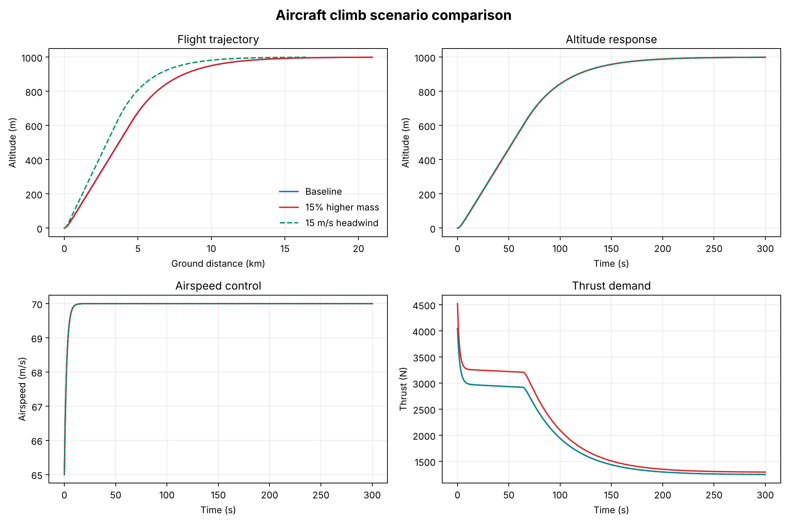

# Aircraft Flight Dynamics and Trajectory Simulation

A two-dimensional, point-mass aircraft simulation in Python. It combines **ISA atmospheric
modelling, aerodynamic lift and drag, propulsion and closed-loop flight control**. The
coupled equations of motion are integrated with a fourth-order Runge–Kutta (RK4) scheme.
The simulation flies a light aircraft from sea level to a 1,000 m cruise altitude and
compares how **extra mass** and a **headwind** affect the climb.



## Key results

Mission: start at sea level at 65 m/s, then climb to and hold **1,000 m at 70 m/s**
(300 s simulated). The aircraft is a light single-engine type (1,200 kg, 16.2 m² wing,
5 kN maximum thrust).

| Scenario | Time to 98% altitude (s) | Final altitude (m) | Ground distance (km) | Max C_L | Peak thrust (N) |
|----------|-------------------------:|-------------------:|---------------------:|--------:|----------------:|
| Baseline        | 179.3 | 999.1 | 20.93 | 0.399 | 4,049 |
| 15% higher mass | 178.5 | 999.2 | 20.93 | 0.441 | 4,521 |
| 15 m/s headwind | 179.3 | 999.1 | 16.43 | 0.399 | 4,049 |

- **The climb has two phases.** The flight-path angle is limited to 8°, so the aircraft first
  climbs at a constant ~9.7 m/s. Once it is within ~400 m of the target, the altitude loop
  leaves that limit and the aircraft approaches 1,000 m smoothly and asymptotically, with no overshoot.
- **A 15% heavier aircraft follows the same trajectory but works harder.** Holding the same
  speed and flight path needs about **15% more lift coefficient** in cruise (0.267 → 0.307) and
  **~10% more thrust** during the climb (2,950 → 3,240 N). The peak thrust demand rises to
  4.5 kN, cutting the margin below the 5 kN engine limit from ~19% to ~10%. A heavier aircraft,
  or a weaker engine, would hit the thrust limit and climb more slowly.
- **A headwind changes nothing relative to the air, only relative to the ground.** Airspeed, altitude,
  lift and thrust are the same as the baseline (the dashed line sits on top of it). Ground
  distance falls by exactly 15 m/s × 300 s = **4.5 km**, and the climb gradient over the ground
  gets steeper. This is the expected physics, and it acts as a built-in check on the model.

## Model

**State:** horizontal position `x`, altitude `h`, true airspeed `V`, flight-path angle `γ`.

**Equations of motion** (point mass, wings-level flight in the vertical plane):

```text
dx/dt = V·cos γ + V_wind
dh/dt = V·sin γ
dV/dt = (T − D)/m − g·sin γ
dγ/dt = (L − m·g·cos γ) / (m·V)
```

**Aerodynamics:**

```text
q   = ½ ρ(h) V²                 dynamic pressure
L   = q S C_L                   lift
D   = q S (C_D0 + k C_L²)       drag: parasite + induced (drag polar)
```

**Atmosphere:** International Standard Atmosphere (troposphere). Temperature falls at
6.5 K/km and pressure follows the hydrostatic relation. Density comes from the ideal gas law
(1.225 kg/m³ at sea level, 1.112 kg/m³ at 1,000 m).

**Flight control** (a simple autopilot with physical limits):

```text
γ_cmd = clip( K_h · (h_target − h),  ±8° )                            altitude loop
C_L   = clip( C_L,trim + K_γ · (γ_cmd − γ),  0.05 … C_L,max )         flight-path loop
T     = clip( D + m·g·sin γ + m·K_V · (V_target − V),  0 … T_max )    airspeed loop
```

The lift and thrust commands include **feed-forward** terms (trim lift and the
drag-plus-climb force), so the feedback gains only have to correct small errors.

| Parameter | Value |
|-----------|-------|
| Mass | 1,200 kg |
| Wing area | 16.2 m² |
| Zero-lift drag coefficient, C_D0 | 0.025 |
| Induced-drag factor, k | 0.045 |
| Maximum lift coefficient | 1.40 |
| Maximum thrust | 5,000 N |

## Tech stack

Python 3.10+ · NumPy · pandas · Matplotlib · pytest

## Getting started

```bash
python -m venv .venv
source .venv/bin/activate          # Windows: .venv\Scripts\activate
python -m pip install -r requirements.txt

python scripts/run_simulation.py   # run all scenarios, write results to outputs/
python -m pytest                   # run the test suite
```

The simulation can also be used as a library:

```python
from dataclasses import replace
from flight_dynamics import AircraftParameters, simulate_flight, summarise_flight

heavy = replace(AircraftParameters(), mass=1_500.0)
data = simulate_flight(heavy, duration=300.0, target_altitude=1_500.0)
print(summarise_flight(data, target_altitude=1_500.0))
```

The script writes the following to `outputs/`:

| File | Contents |
|------|----------|
| `flight_scenarios.png` | Trajectory, altitude, airspeed and thrust for all scenarios |
| `scenario_metrics.csv` | Performance metrics per scenario |
| `analysis_summary.md` | Short auto-generated summary |
| `<scenario>.csv` | Full time histories (generated locally, not committed) |

## Project structure

```text
aircraft-flight-dynamics/
├── src/flight_dynamics/
│   ├── __init__.py
│   └── model.py             # atmosphere, aerodynamics, equations of motion, autopilot, RK4
├── scripts/
│   └── run_simulation.py    # scenario comparison, figure and metrics
├── tests/
│   └── test_model.py
├── outputs/                 # generated figure, metrics and summary
├── pyproject.toml
└── requirements.txt
```

## Testing

- Air density decreases with altitude
- The baseline climb settles within 25 m of the target altitude
- A headwind reduces ground distance but leaves airspeed unchanged (a physics consistency check)
- Lift coefficient and thrust never exceed their physical limits

## Limitations

This is a simplified point-mass model for performance studies. It is not a certified
flight-dynamics tool.

- No rotational dynamics. Pitch attitude, moments, stability derivatives and control-surface
  deflections are not modelled. The autopilot commands lift coefficient directly.
- No stall or post-stall behaviour beyond a hard limit on maximum C_L. No compressibility effects
  (reasonable at these low Mach numbers).
- Thrust is constant with altitude and speed. There are no engine dynamics or fuel burn, so mass
  stays constant.
- Wind is a steady horizontal component. There is no gust, shear or turbulence model.
- The aircraft parameters represent a typical light aircraft rather than a specific type.

## Possible extensions

- Altitude- and speed-dependent propeller thrust and fuel burn (changing mass)
- Longitudinal 3-DOF model with pitch dynamics and elevator control
- Wind shear and gust response
- Optimal climb schedules (best rate vs best angle of climb)
- Monte Carlo study over mass, wind and drag uncertainty
